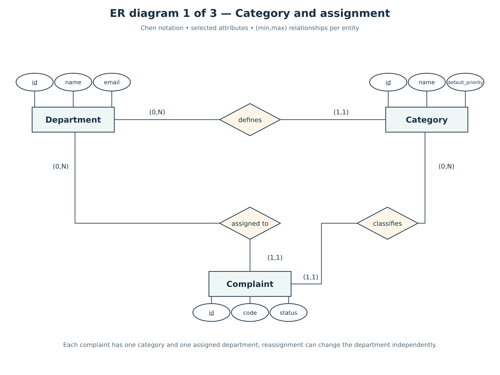
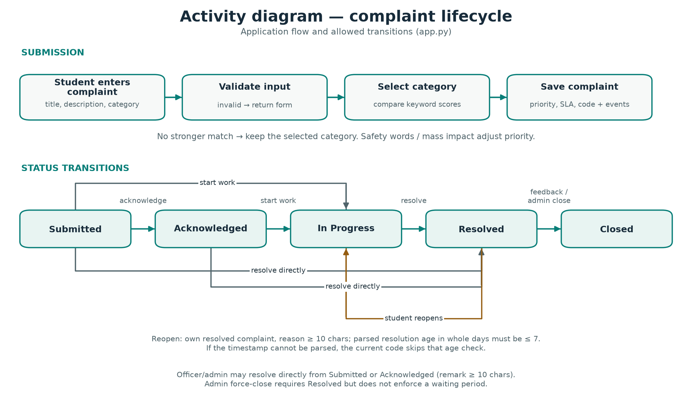

# Campus Shikayat Setu
## Deep Understanding and Viva Q&A Guide

**For:** Yashwant Santosh Ahire | **Course:** SPPU MCA-I, Semester I mini project

**How to use this guide:** Read Part A with the project open. Run the demo in Part B. Then cover the answers in Part C and explain them in your own words. The answers describe the current implementation, including its limits; do not claim features you have not implemented or work you cannot explain.

---

# PART A — UNDERSTAND THE PROJECT

## 1. The project in one minute

Campus Shikayat Setu is a local, role-based college complaint-management web application. A student submits a grievance with a title, description and chosen category. The application compares keyword scores, selects a category and department, sets a priority and an SLA deadline, and generates a tracking code. A department officer can acknowledge, start work on and resolve complaints assigned to their department. The student can give feedback to close a resolved complaint or, subject to the implemented checks, reopen it. An administrator can monitor, reassign and escalate complaints, manage users and view reports. A complaint's events are shown as a timeline. The application uses Python, Flask, SQLite, Jinja templates and vanilla JavaScript.

This is an explainable rules-based mini project, not machine learning. It is a local demonstration, not a production-ready service.

## 2. The problem, users and outcome

- **Problem:** Complaints made through scattered conversations or paper records can be difficult to route, follow up and review consistently.
- **Objective:** Keep complaint details, assignment, status changes and feedback together, with role-specific views and printable summaries.
- **Student:** Registers, logs in, submits and views own complaints, provides feedback and may reopen an eligible resolution.
- **Officer:** Views the assigned department queue and performs complaint actions permitted for that department.
- **Administrator:** Has system-wide access, can reassign and escalate, manage users, force-close resolved complaints and view six reports. Admins can also use officer actions.
- **Public visitor:** Can use the tracker with the complaint code and the student's roll number. A signed-in admin can bypass the roll-number check in this route.
- **Outcome:** A traceable complaint and a clearer view of work. The system supports follow-up; it does not guarantee that a department actually resolves the issue.

## 3. Architecture: follow one request

1. The browser displays an HTML form rendered from a Jinja template. Local CSS and JavaScript improve the interface.
2. The browser sends an HTTP request to a Flask route in `app/app.py`. A GET usually requests a page; a POST usually submits or changes data.
3. The route checks the session, role and, where relevant, ownership or department. The server validates submitted data even when JavaScript has already provided feedback.
4. Business rules call functions in `app/routing.py`; database work uses `app/database.py` and parameterized SQLite queries. Flask `g` holds the connection, and teardown rolls back uncommitted work and closes it.
5. Flask commits the change and typically redirects to another page. Jinja renders the result, complaint list or timeline.

A useful memory map is: **Browser → Flask route → authorization and validation → routing/SQLite → response**. The browser is not the database; the JavaScript preview is not the authoritative submission.

### Technology and reasons

- **Python:** General-purpose language used for server logic and routing rules.
- **Flask:** Lightweight framework that maps URLs to Python functions and manages requests, sessions and template rendering.
- **SQLite:** File-based relational database appropriate for a small local demo; no separate database server is needed.
- **Jinja:** Generates server-rendered HTML using data passed from Flask. Autoescaping helps reduce HTML injection in normal templates.
- **HTML/CSS/vanilla JavaScript:** Forms, responsive presentation and small interactive features such as route preview and filters; no frontend framework is required.
- **pytest:** Runs automated tests with isolated temporary databases.

## 4. File-by-file reading order

1. `run.py` — adds the app directory to the import path, calls `init_db()` and `seed_if_empty()`, then runs Flask on port 5001 by default with debug disabled. `SHIKAYAT_PORT` can change the port.
2. `app/schema.sql` — defines tables, constraints, relationships and indexes. Start here to understand stored data.
3. `app/database.py` — opens SQLite connections, enables foreign keys, initializes the schema and inserts demo records if there are no users. The default file is `app/shikayat_setu.db`; environment variable `SHIKAYAT_DB` can change it.
4. `app/routing.py` — contains `score_category`, `route`, `assign_priority`, `route_text` and the SLA mapping.
5. `app/app.py` — Flask routes, authorization helpers, submission and status rules. Read `select_category`, `lodge`, `get_for_action`, `resolve`, `feedback` and `reopen` in that order. The category-selection helper delegates to `routing.select_category`, also used during seeding.
6. `app/templates/` — Jinja pages. Follow `lodge.html`, `complaint_detail.html`, `queue.html`, `console.html` and `reports.html`.
7. `app/static/js/app.js` and `app/static/css/style.css` — preview, display behavior and styling. JavaScript uses the same-origin `/api/route-preview` endpoint.
8. `tests/test_app.py` and `tests/test_diagrams.py` — examples of expected behavior and schema/diagram checks. `report/diagrams/` contains editable diagrams.net sources.

## 5. Database: six tables and their relationships

- `departments`: `id`, unique `name`, head, email and location. One department can be referenced by multiple categories, users or complaints.
- `categories`: `id`, unique `name`, required `department_id`, `default_priority` and comma-separated `keywords`. Each category points to one department.
- `users`: role, unique username, password hash, name, optional unique roll number, phone, optional department and status. The role check allows student, officer or admin. Department is normally used for officers; that convention is not fully enforced by the database.
- `complaints`: unique tracking code; student, category and assigned department foreign keys; title, description, location, priority, routing type and score, status, anonymous flag and timestamps. A complaint stores both category and department: reassigning a department does not change the category.
- `complaint_events`: complaint foreign key, event type, note, optional actor and time. Multiple events may belong to one complaint. A missing actor can represent an automated event.
- `feedback`: a unique complaint foreign key, rating from 1 to 5, optional comment and timestamp. The unique key permits at most one feedback row for a complaint.



**Key terms:** A primary key identifies a row. A foreign key references a row in another table. `NOT NULL` makes a value required; `UNIQUE` prevents duplicate non-null values; `CHECK` restricts accepted values. `get_conn()` enables `PRAGMA foreign_keys = ON` for each connection. Indexes on complaint department/status, student and event complaint help the corresponding lookups.

**Important limitation:** Registration validates an email address but the current `users` table and insertion do not store it. Do not say the system saves student email or sends email notifications.

## 6. Complaint submission: exact path

1. A logged-in student opens `/lodge` and supplies a valid category, title and description. Location and the anonymous option may also be supplied.
2. Server checks title length of at least 8 characters and description length of at least 20 characters, and verifies the category ID. Invalid data returns the form with messages and HTTP 400.
3. `select_category` calls the keyword router and compares its best result to the selected category's score. A stronger competitor can override the selection. If there is no stronger match, the selected category is retained.
4. The selected final category provides the initial department and default priority. Safety and mass-impact rules may adjust priority. A deadline is calculated from the current local time and the selected SLA hours.
5. The route inserts a complaint, uses its new numeric ID to form a code such as `CMP-2026-0033`, inserts `created` and `routed` events, commits and redirects to the student's list. The actual number and year depend on the database and submission time.
6. The browser preview requests the same category-selection logic before submission. It is informative; the server recalculates when the complaint is submitted.

## 7. Keyword routing: calculate it yourself

**Rules in `routing.py`:** `route_text` combines the title twice and the description once. For each comma-separated category keyword, `score_category` matches the complete keyword or phrase using boundaries against ASCII letters and digits, case-insensitively. Every hit adds `2 × number of words in the keyword`. So a one-word keyword gives 2 points per hit and a two-word phrase gives 4 points per hit. The best score wins inside `route`; equal best scores retain the first category in the list supplied to it. Do not promise a database-independent order: the query loading categories does not specify `ORDER BY`.

**Worked example using the seeded keywords:** Student selects IT & Network. Title: `Water tap leak`. Description: `Water tap leak in hostel room.` The scoring text contains the title twice and the description once. For Water & Plumbing, `water`, `tap` and `leak` each appear three times: 3 keywords × 3 hits × 2 points = **18**. For Hostel Room & Mess, `hostel` and `room` occur once in the description: 2 keywords × 1 hit × 2 = **4**. IT & Network has no match in this example. Water & Plumbing is the stronger category, so it is selected and its department is used. This arithmetic assumes the displayed seed keyword lists are unchanged.

**Selected-category nuance:** `select_category` returns the router's result when it is the chosen category or its score is greater than the chosen category's score. Otherwise it retains the chosen category with routing value `manual` and score 0. Thus a tie with a different chosen category does not automatically override the choice. After an admin reassigns the department, routing is also marked `manual`.

**Priority:** Start with the final category's default priority. If any safety substring such as `shock` or `fire` appears in title or description, priority becomes High. Otherwise a mass-impact phrase such as `whole` or `all students` increases Low to Medium or Medium to High; High stays High. Safety matching uses substring checks, which differ from the router's keyword-boundary matching.

**SLA mapping:** High = 24 hours; Medium = 72 hours; Low = 168 hours (7 days). `sla_due_at` is set at submission. The admin escalation route changes priority to High but does not recompute the original deadline. A complaint is overdue when the deadline has passed and its status is not Resolved or Closed. This is derived, not a stored status.

## 8. Lifecycle and who can do what

- **Submitted → Acknowledged:** officer/admin may acknowledge a Submitted complaint.
- **Submitted or Acknowledged → In Progress:** officer/admin may start work; acknowledgement is not mandatory.
- **Submitted, Acknowledged or In Progress → Resolved:** officer/admin may resolve directly; a remark of at least 10 characters is required and `resolved_at` is set.
- **Resolved → Closed:** normally the owner submits a rating from 1 to 5 and optional comment. The feedback endpoint also permits an admin; the user-facing messages still refer to the student. An admin can instead force-close a Resolved complaint without feedback.
- **Resolved → In Progress:** the owning student may reopen with a reason of at least 10 characters, subject to the implemented time check.
- **Reopen time nuance:** The code rejects when `(now - resolved_at).days > 7`. `.days` uses whole days, so this is not an exact 168-hour cutoff. If the timestamp is missing or cannot be parsed, reopening is rejected and the user is asked to contact the administration. Reopening does not recalculate the original SLA deadline.
- **Force-close nuance:** The current route requires Resolved status but does not enforce a waiting period. It is not an automatic scheduled task.



Status transitions use a conditional update against the observed status, assignment and resolution timestamp, so concurrent duplicate actions do not each create a transition event. Events capture actions such as creation, routing, acknowledgement, resolution, reassignment and reopening. They are stored as database rows and displayed in time/id order. The application mainly inserts events; the schema does not make the event table cryptographically tamper-proof or immutable.

## 9. Access control and privacy

`login_required` checks for a session user; `role_required` restricts roles. `can_see` applies complaint-level rules: an admin can access all, a student only their own, and an officer only their department's complaints. `get_for_action` checks visibility before complaint actions. SQLite queries use placeholders for values instead of joining user input directly into SQL.

An anonymous complaint still stores the student's ID. In officer-facing views the identity fields and student event actor are masked; administrators can see the identity. A description or other free text might identify the student. This is therefore **identity masking**, not full anonymity. Public tracking normally requires both code and roll number, which should not be treated as a strong secret.

This is a demo: Flask-WTF checks CSRF tokens on POST forms, but the fallback secret and demo passwords are insecure. Set a strong private `SHIKAYAT_SECRET_KEY` before deployment. The app uses Flask's development server; stronger session management, rate limiting, HTTPS and a security review are still needed. Inactive or deleted accounts lose access on their next request; role and department are refreshed from the database. This does not revoke a copied session if an account is later reactivated. Avoid claiming the app is fully secure.

## 10. Reports, diagrams and tests

The fresh demo seed has 37 synthetic complaints, including five clearly labelled historical examples; seeding never overwrites an existing database. The routing summary has two modes, with at least five manual examples listed separately. The admin's six printable views are: **department pendency**, **SLA compliance**, **average resolution time by category**, **monthly trend**, **feedback** and **routing**. They are calculated from SQLite queries, not downloaded from an outside analytics service. The monthly trend groups by submission month and shows current status, not the month of resolution. The pendency query uses `COUNT(c.id)` so empty departments show zero. SLA and average resolution time calculations include complaints currently Resolved or Closed, not reopened In Progress complaints; the stored resolution timestamp is overwritten on the next resolution.

Explain the diagram types: architecture shows request/data layers; ERD shows six tables and foreign keys; the use-case file has separate pages for student, officer, administrator and the external public visitor; activity/lifecycle shows submission and allowed transitions; deployment shows a browser and local Flask/SQLite computer; module hierarchy maps actual files. The class/record diagram is conceptual: the project uses SQLite rows, not ORM model classes. Editable `.drawio` sources were programmatically generated and rendered with diagrams.net; do not represent them as manually drawn in another tool.

The test suite has 109 test cases at the time of this guide, including CSRF, rollback, configuration, reopen handling and a diagram/schema consistency test. Coverage includes authentication, registration, routing, preview, permissions, lifecycle, reports and anonymous-event masking. Tests passing is useful evidence, not proof of absence of defects. Run them yourself before the viva.

# PART B — RUN AND DEMONSTRATE

## 11. Start the project

From a terminal in `shikayat-setu/`:

```text
python -m venv .venv
source .venv/bin/activate       # Linux/macOS
.venv\Scripts\activate          # Windows, instead of source
pip install -r requirements.txt
python run.py
```

Open `http://127.0.0.1:5001` on the same computer. The first run creates and seeds the local database if appropriate. Stop the server with Ctrl+C. If the port is occupied, stop the other process or change the port in your own local configuration; do not claim the site is running unless you have started it.

Run `python -m pytest tests/ -q` from the project directory. To reset a disposable demo database, stop the app and remove `app/shikayat_setu.db`; the next run creates it again. **This permanently removes local complaints and changes**, so do not do it with data you need. If `SHIKAYAT_DB` is set, the app uses that other path instead. Demo credentials below are intentionally weak and must not be reused for a real deployment.

- Student: `MCA2026001` / `student123`
- Officer: `hostel.officer` / `officer123` (other seeded departments have corresponding officers).
- Admin: `admin` / `admin123`

## 12. Five-minute viva demonstration

1. **Student:** Log in, show the dashboard and lodge a non-sensitive sample complaint. Explain title, description, chosen category, preview, category/department, priority and SLA. Submit it and note its generated code.
2. **Routing:** Explain one keyword score and why the chosen category may be retained. A preview is not a saved complaint.
3. **Officer:** Log out and sign in as the officer of the complaint's actual assigned department. Open the queue and show the complaint. Acknowledge or start work, then resolve with a remark of at least 10 characters. If routing chose a different department, use the appropriate officer or show it through admin.
4. **Student:** Sign in again and show the timeline. Give a rating to close the complaint, or demonstrate reopen on a different eligible Resolved complaint. You cannot both reopen and close the same resolution in a single uninterrupted step without resolving it again.
5. **Admin:** Show the console, reassign/escalate options and one or two reports. Explain that escalation does not recalculate the stored SLA and that force-close has no enforced wait.
6. **Tracker and limitations:** Log out, use the correct code and roll number in public tracking, and explain identity masking and demo security limits.

Use fictional or test information only. Seed data and relative dates may change after resetting; do not promise a particular complaint ID or report total.

## 13. A 30-second opening answer

“Campus Shikayat Setu is a Flask and SQLite mini project for recording and following college grievances. A student submits a complaint, and an explainable keyword rule helps choose its category and department. The system assigns priority and a deadline, records updates from the responsible officer, and lets the student give feedback or reopen an eligible resolution. An administrator monitors assignments and reports. I can explain the database, routing algorithm, access checks and current limitations.”

# PART C — VIVA QUESTIONS AND ANSWERS

## Project and architecture

### Q1. What is the main aim of this project?
To organize grievance submission, department assignment, progress tracking and administrative reporting in one small application.

### Q2. What problem does it solve?
It reduces dependence on scattered complaint communication by providing an identifiable record, current status and a history of actions. It supports rather than guarantees resolution.

### Q3. Who are the actors?
Student, department officer, administrator and public visitor. The public visitor can use the tracker with a code and roll number.

### Q4. Is it a website or a mobile app?
It is a responsive web application. A mobile browser can use it, but it is not a native Android or iOS application.

### Q5. Which technologies did you use?
Python and Flask for the backend, SQLite for data, Jinja for server-rendered HTML, and local CSS and vanilla JavaScript for the interface. pytest runs automated tests.

### Q6. Why Flask?
Its routing and template support are small enough for a mini project and easy to follow. It does not force a large framework structure for this scope.

### Q7. Why SQLite instead of MySQL?
SQLite works as a local file with minimal setup, which suits this demo. A larger multi-user production deployment would need a review of concurrency, backups and a suitable database; migration is not just a connection-string change.

### Q8. Is the application three-tier?
It has browser/presentation, Flask/application and SQLite/data responsibilities. In the demo the application and database run on one machine, so these are logical layers rather than three separately deployed servers.

### Q9. What happens when the application starts?
`run.py` initializes the schema, calls `seed_if_empty()` and starts Flask on port 5001. Seeding is skipped when the users table already contains users.

### Q10. Where is data stored?
In SQLite at `app/shikayat_setu.db` by default. `SHIKAYAT_DB` can select another path. The local database is ignored by Git and is not included in the project ZIP.

### Q11. What is a Flask route?
A function mapped to a URL and allowed HTTP methods. For example, `/lodge` displays the complaint form on GET and processes it on POST.

### Q12. What does Jinja do?
It fills HTML templates with data from Flask, such as complaint details or report rows. This is server-side rendering.

### Q13. What does JavaScript do here?
It improves the browser experience with route preview, counters, filters, navigation and visual behavior. The backend still checks and processes the submission.

### Q14. What is the role of `/api/route-preview`?
It accepts the proposed title, description and selected category from a logged-in user and returns category, department, priority, score and SLA in JSON. It does not create a complaint.

### Q15. Does a successful preview guarantee the submitted data will be accepted?
No. The server validates and recalculates on POST; the form or database may have changed between preview and submission.

## Complaint handling and routing

### Q16. Which fields are mandatory when lodging a complaint?
A valid category, a title of at least 8 characters and a description of at least 20 characters. Location and the anonymous flag may also be submitted.

### Q17. How is a complaint code made?
After insertion, the route uses the current year and numeric complaint ID, formatted like `CMP-2026-0033`. The actual code depends on the record and year.

### Q18. How is a department selected?
The final category contains a department foreign key. On submission that department is copied into the complaint's assigned department field; an administrator may later reassign it.

### Q19. How does keyword scoring work?
It counts complete keyword or phrase matches, case-insensitively. Each hit gets two points per word in that keyword; the scoring input includes the title twice and description once.

### Q20. Why count the title twice?
It gives the title more influence because it often summarizes the issue. It is a design choice, not a learned weight.

### Q21. How do multi-word keywords affect the score?
A two-word keyword gives 4 points per match, while a one-word keyword gives 2, before considering how many times it appears.

### Q22. What happens when no keyword matches?
The student's selected valid category remains selected. The application does not always send unmatched complaints to General & Administration.

### Q23. What happens if a different category scores higher?
`select_category` can select the stronger match and use its department. If the scores tie, the chosen category can remain; the exact result also depends on which category `route` encounters first.

### Q24. Why can a retained category have `manual` and score 0?
That is how the current `select_category` fallback represents the retained selection, even when the chosen category has a nonzero score tied with another category.

### Q25. Is routing artificial intelligence or machine learning?
No. It is deterministic keyword and priority logic. There is no trained model, training dataset, NLP classifier or claimed prediction accuracy.

### Q26. What are the weaknesses of keyword matching?
It can miss spelling errors, synonyms and context, and a word may have an unintended meaning. Category ties and incomplete keyword lists also affect results.

### Q27. How is priority assigned?
The final category's default priority is adjusted by safety substrings or mass-impact phrases. Safety forces High; mass impact otherwise bumps priority by one level up to High.

### Q28. What does SLA mean in this project?
Service-level target: the deadline is submission time plus 24, 72 or 168 hours for High, Medium or Low priority respectively. It is a target, not a guarantee.

### Q29. How do you decide whether a complaint is overdue?
The app compares the stored deadline with current time and excludes complaints whose current status is Resolved or Closed. Overdue is derived, not a separate stored status.

### Q30. Does escalation reset the deadline to 24 hours?
No. The current admin escalation changes priority to High and logs an event, but it keeps the previously stored deadline.

### Q31. Is the complaint assigned directly to a particular officer?
The complaint stores a department, not a specific officer assignment. An officer can access complaints for their department.

## Status, feedback and audit

### Q32. What are the stored complaint statuses?
Submitted, Acknowledged, In Progress, Resolved and Closed. Overdue is a derived condition, not another status.

### Q33. Must every complaint pass through every status in order?
No. An officer/admin can start work directly from Submitted and can resolve from Submitted or Acknowledged as well as In Progress.

### Q34. What is required to resolve a complaint?
An authorized officer or admin, an allowed current status, and a resolution remark of at least 10 characters. The route sets `resolved_at` and adds an event.

### Q35. What is the difference between Resolved and Closed?
Resolved means a solution was recorded and the complaint awaits confirmation or another action. Closed is the final state after feedback or an admin force-close.

### Q36. How does feedback work?
For an eligible Resolved complaint, the owner chooses a rating from 1 to 5 and an optional comment. The route saves feedback, changes the status to Closed and records events. The endpoint also permits admins.

### Q37. Can a complaint have multiple feedback rows?
The `complaint_id` column in `feedback` is unique, so the database allows at most one current feedback row per complaint. The endpoint uses `INSERT OR REPLACE`.

### Q38. When can a student reopen a complaint?
The student must own it, it must be Resolved and the reason must contain at least 10 characters. The route requires a valid `resolved_at` timestamp and applies the whole-day age check.

### Q39. Is the reopen cutoff exactly seven days?
No. The code checks whether the difference's whole-day `.days` value exceeds 7. If the timestamp is missing or invalid, the route rejects reopening. An exact-duration rule is a possible improvement.

### Q40. What happens to the deadline after reopening?
The current reopen route changes the status to In Progress and records an event; it does not create a new SLA deadline.

### Q41. What is force-close?
An admin action that closes a Resolved complaint without requiring feedback. The current implementation does not enforce a waiting period.

### Q42. What is the timeline?
A chronological display of `complaint_events` records. Events store a type, note, optional actor and timestamp for a complaint.

### Q43. Are timeline records tamper-proof?
No. The application normally adds events instead of editing them, but SQLite itself does not prevent a database administrator from changing them.

### Q44. Does the app send email or SMS when a complaint changes?
No. There is no email/SMS delivery service in the implementation. A reopened complaint returns to the department queue, where an officer can see it.

## Database and SQL

### Q45. How many tables are in the schema?
Six: departments, categories, users, complaints, complaint_events and feedback.

### Q46. What is the primary key of complaints?
`id` is its integer primary key. `code` is also unique, but it is the human-facing tracking identifier rather than the primary key.

### Q47. What is a foreign key? Give an example.
A foreign key links a value to an existing row in another table. `complaints.category_id` references `categories.id`.

### Q48. How many foreign-key relationships are present?
Eight declared foreign keys: category→department, user→department, complaint→student, complaint→category, complaint→department, event→complaint, event→actor and feedback→complaint.

### Q49. What is the relationship between complaint and feedback?
One complaint can have zero or one feedback row because `feedback.complaint_id` is unique. Each feedback row references one complaint.

### Q50. Why keep category and assigned department separately?
The category describes the issue and supplies an initial department. An admin can reassign the responsible department without changing the issue's category.

### Q51. What is a JOIN? Where is it used?
A JOIN combines related rows. `get_complaint` joins complaints with category, department and student data to show meaningful names instead of only numeric IDs.

### Q52. What is `ON DELETE CASCADE` here?
For example, deleting a complaint can delete its related events and feedback through their declared foreign keys. It requires foreign-key enforcement on the connection. The application is not presenting this as a routine delete workflow.

### Q53. What is the purpose of an index?
An index helps selected database lookups. This schema indexes complaint department/status, complaint student and event complaint ID; it also adds storage and maintenance cost.

### Q54. How do you reduce SQL injection risk?
The app uses parameter placeholders such as `WHERE id=?` for values. Some query fragments are assembled from fixed conditions; parameterization is still important wherever user values enter a query.

### Q55. Are student email addresses stored?
No. The registration form validates an email address, but the current users schema and INSERT do not save it. Storing it correctly would require a schema and application change.

## Authentication, security and privacy

### Q56. What is authentication versus authorization?
Authentication checks who the user is, such as verifying a password. Authorization checks what that user may access, such as their own complaint or their department's queue.

### Q57. How are passwords stored?
The app uses Werkzeug's `generate_password_hash` and checks with `check_password_hash`; it does not store the original password in the user table. The seeded demo passwords are still weak.

### Q58. How are sessions used?
After login, the app stores identifiers and role information in Flask's signed session. The key can be set through `SHIKAYAT_SECRET_KEY`; the built-in fallback is only for the demo. Signing prevents undetected modification when the secret is protected; it does not make the cookie contents secret.

### Q59. How does an officer get restricted to their department?
The queue query filters on the officer's department, and complaint-level access is checked by `can_see` for detail/actions. An administrator can see all departments.

### Q60. Does the app provide full anonymity?
No. The student ID remains in the database. Officers see masked identity fields and masked student event actors for anonymous complaints; admins can see the identity, and free text can reveal it.

### Q61. Is code plus roll number strong authentication?
No. It is a simple demo tracking check, not a strong secret or a replacement for proper identity verification, rate limiting and privacy controls.

### Q62. What security work is needed before real deployment?
Use a protected secret and non-default credentials; the app already checks CSRF tokens on POST forms. Add HTTPS, rate limits, stronger session and account controls, security testing and secure deployment/backups. Login redirects are restricted to local paths. Do not expose the development server publicly as-is.

### Q63. What happens when an account is deactivated?
The login route rejects inactive accounts. On the next request, an existing session for an inactive or deleted account is cleared. A copied cookie could still work after reactivation, so stronger revocation would be needed for production.

## Reports, testing and viva challenges

### Q64. Name the six reports.
Department pendency, SLA compliance, average resolution time by category, monthly trend, feedback and routing summaries.

### Q65. How is average resolution time calculated?
The report calculates the difference between `resolved_at` and `submitted_at` using SQLite `julianday`, converts it to hours and averages by category for currently Resolved or Closed rows with a resolution timestamp.

### Q66. What is one reporting limitation?
The pendency report uses `COUNT(c.id)` with a LEFT JOIN, so departments with no complaints show zero rather than counting the unmatched join row.

### Q67. What tests are included?
The current suite has 109 test cases, including CSRF, rollback, configuration, reopen handling and schema/diagram consistency. Examples include login, registration, routing, preview, permissions, lifecycle, reports and anonymous actor masking.

### Q68. Does passing the tests prove there are no bugs?
No. Tests check selected cases; untested inputs, concurrency, security issues and real-world behavior may still reveal defects.

### Q69. How would you test a permission rule?
Log in as a student and request the admin console; the expected response is 403. Also test that an officer cannot open a complaint belonging to another department.

### Q70. How would you test keyword tie handling?
Construct categories with equal scores and explicitly assert `route`'s first-in-list behavior, then test `select_category` when the student's choice is the other tied category.

### Q71. How would you test the SLA?
Create a complaint at a controlled time and verify that its deadline equals submission plus the expected priority hours. Test overdue behavior before and after the deadline, including Resolved and Closed statuses.

### Q72. What is the difference between unit and integration tests?
A unit test checks a small function such as keyword scoring. An integration test checks components working together, for example a Flask request that updates a temporary SQLite database.

### Q73. Which diagrams can you explain?
I can explain architecture, ERD, use case, complaint lifecycle/activity, conceptual class/record model, deployment and module hierarchy. The record model is conceptual; there are no ORM model classes.

### Q74. What tool produced the editable diagrams?
The `.drawio` source files were generated programmatically and rendered using diagrams.net. They can be opened and edited there; I should not claim they were manually drawn in StarUML or EdrawMax.

### Q75. What is one limitation you would fix first?
For a real rollout, I would prioritize security and correctness: replace demo secrets/passwords, strengthen session protections, consider an exact reopen rule, continue testing report and security edge cases. CSRF protection, invalid-timestamp rejection, local redirect validation and the identified report fixes are already implemented; stronger production controls are proposed work.

### Q76. What future features are possible?
Notifications, attachment support, category administration, improved search and a production deployment are possible future additions. They are not existing features in this mini project.

### Q77. What if the examiner asks something you do not know?
State what you understand, identify the relevant file and say you would verify the implementation. Do not invent functionality, measurements or authorship details.

### Q78. How does the application protect POST forms against CSRF?
Flask-WTF issues a session-linked token in each POST form and rejects missing or invalid tokens. Sign-out is also a protected POST. The demo secret must be replaced for deployment, and CSRF protection alone does not make the app production-ready.

### Q79. How are database connections closed safely?
Flask `g` holds a connection for the current application context. Teardown rolls back any uncommitted transaction and closes it, including on errors. Schema setup and seeding use closing contexts; seeding also uses a transaction.

# PART D — SELF-CHECK

## 14. Practice without looking

- Draw the six tables and explain the complaint's three foreign keys.
- Explain the Water/tap/leak scoring example and the selected-category tie rule.
- Trace one request from HTML form through Flask, validation, routing, insert, event logging and redirect.
- Explain who can see an anonymous complaint and why free text remains a risk.
- Demonstrate a direct Submitted → Resolved transition and explain the mandatory remark.
- Explain why reopen is not an exact 168-hour rule and why admin force-close has no enforced wait.
- Name all six reports and one known counting limitation.
- Run the tests, explain one test and identify the difference between tested behavior and a security guarantee.
- Open the diagrams.net source, identify the ERD and explain why the class diagram is conceptual.

**Final reminder:** Understand the code, run the project and adapt these explanations to what you can personally demonstrate. This guide is a learning aid, not proof of authorship or a guarantee of viva results.
